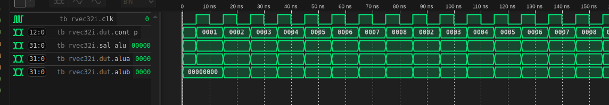
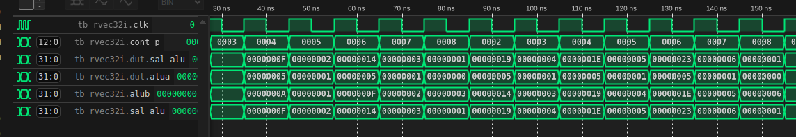

# RISCV-EC-v1.0
The first Ecuadorian open-source RISC-V soft processor for Edge Computing applications.  
This repository provides a SystemVerilog (SV) simulation of the RISCV-EC processor with additional benchmark kernels, simulated using Verilator. It is a continuation of the work presented in the 2025 publication:  
This version corresponds to the architecture and performance analysis presented in the 2025 publication:  
**“Evaluating the RISCV-EC: A Comparative Analysis of Instruction Efficiency and Power Performance for Edge Computing.”**

---

## Contents
- Overview
- Microarchitecture
- Performance Evaluation
- Future Work
- Repository
- File Tree
- Simulation with Verilator and GTKWave
- Convert C Kernels to RISC-V Assembly
- Citation
- Authors

---

## Overview
**RISCV-EC-v1.0** is a soft processor based on a **5-stage, multi-cycle, non-pipelined architecture** implemented in **VHDL** for FPGA devices.  
It executes each instruction in its entirety before proceeding to the next, focusing on **instruction efficiency**, **execution speed**, and **power-performance balance** for **edge computing** environments.

This repository also provides a SystemVerilog simulation flow using Verilator, with waveform inspection in GTKWave.  
These simulations aim to obtain benchmark metrics that can later be used to compare RISCV-EC against other RISC-V cores.

---

## Microarchitecture
RISCV-EC follows the standard **RISC-V single-core ISA** and includes the following stages (matching the SV implementation):

1. **Instruction Fetch (IF)** – Fetches instructions from the 256-word ROM (`rtl_sv/prog_m.sv`).  
2. **Instruction Decode (ID)** – Decodes opcode and operands; handles register and immediate values (`rtl_sv/decoder.sv`, `rtl_sv/CU.sv`).  
3. **Execute (EX)** – Performs arithmetic and logical operations using the ALU (`rtl_sv/alu.sv`).  
4. **Memory Access (MEM)** – Reads/writes data to the 256-word data memory (`rtl_sv/data_m.sv`).  
5. **Write Back (WB)** – Stores computed results into registers (`rtl_sv/reg_b.sv`).

### Key Components
- **ALU:** `alu.sv` uses an `opcode[3:0]` (4 bits) and supports arithmetic and comparison operations.  
- **Register File:** `reg_b.sv` implements 32 32-bit registers (`mem[0:31]`).  
- **Control Unit:** `CU.sv` decodes `opcode/func3/func7` and generates control signals.  
- **Multiplexers:** `mux2_1.sv`, `mux32.sv`, `mux_4b.sv`, `mux_c.sv` route data between immediates, registers, and memory.

---

## ISA
The following RV32I instructions are implemented in this version. Instruction decode is in `rtl_sv/CU.sv` and ALU operations are in `rtl_sv/alu.sv`.

### R-type (opcode `0110011`)
- `ADD`, `SUB` (func3 `000`, func7 `0000000`/`0100000`)
- `SLL` (func3 `001`)
- `SLT` (func3 `010`)
- `SLTU` (func3 `011`)
- `XOR` (func3 `100`)
- `SRL`, `SRA` (func3 `101`, func7 `0000000`/`0100000`)
- `OR` (func3 `110`)
- `AND` (func3 `111`)

### I-type ALU (opcode `0010011`)
- `ADDI` (func3 `000`)
- `SLTI` (func3 `010`)
- `SLTIU` (func3 `011`)
- `XORI` (func3 `100`)
- `ORI` (func3 `110`)
- `ANDI` (func3 `111`)
- `SLLI` (func3 `001`)
- `SRLI`, `SRAI` (func3 `101`, func7 `0000000`/`0100000`)

### Loads (opcode `0000011`)
- `LB`, `LH`, `LW`, `LBU`, `LHU` (func3 `000`, `001`, `010`, `100`, `101`)

### Stores (opcode `0100011`)
- `SB`, `SH`, `SW` (func3 `000`, `001`, `010`)

### Branches (opcode `1100011`)
- `BEQ` (func3 `000`)
- `BLT` (func3 `100`)
- `BLTU` (func3 `110`)

---

## Performance Evaluation
### RISCV-EC Benchmark Metrics (Simulation)
Metrics are collected in the testbench (`sim/tb_rvec32i.sv`). Cycles are counted on each positive clock edge, instructions are counted when the PC changes, and IPC is computed as `instructions / cycles`. The simulation stops when the kernel writes to data memory address `0xFF` (sentinel), or at a timeout if the sentinel is never written.
| Kernel | Cycles | Instructions | IPC |
| --- | --- | --- | --- |
| `count_down` | 24 | 23 | 0.958333 |
| `count_up` | 24 | 23 | 0.958333 |
| `fibonacci_sec` | 53 | 52 | 0.981132 |
| `mat_mult` | 162 | 161 | 0.993827 |
| `rgb_hlb` | 112 | 111 | 0.991071 |

---

## Simulation with Verilator and GTKWave
This repository includes a SystemVerilog port under `rtl_sv/`, a simulation-ready top module (`rvec32i.sv`), and a testbench in `sim/`.

### Requirements
- Linux (tested on Debian/Ubuntu)
- Verilator (5.x recommended)
- GTKWave
- GNU Make, GCC/G++

### Install dependencies (Debian/Ubuntu)
```bash
sudo apt-get update
sudo apt-get install -y verilator gtkwave build-essential
```

### Simulation workflow
Quick start:
```bash
make -C sim
make -C sim run
```
Run all kernels:
```bash
make -C sim run_all
```
Run a specific kernel:
```bash
./sim/obj_dir/simv +KERNEL=Algorithms/rv32i/mat_mult.s
```

Notes:
- Default kernel is `Algorithms/rv32i/count_up.s`.
- Available kernels (from `Algorithms/`): `count_down`, `count_up`, `fibonacci_sec`, `mat_mult`, `rgb_hlb`.
- `make -C sim` builds only; `make -C sim run` builds (if needed) and runs.
- The testbench assembles the `.s` kernel, converts it to `kernel.hex`, loads it into instruction ROM (`prog_m_0.mem`), and runs until the kernel writes to `0xFF` (or a timeout). `sim/wave.vcd` is generated.
  Example sentinel write in C:
  ```c
  *(volatile uint8_t *)0xFF = 1;
  ```

Expected console output (examples):
```
-**************************************************
* Running Algorithms/rv32i/mat_mult.s
**************************************************
- V e r i l a t i o n   R e p o r t: Verilator 5.032 2025-01-01 rev (Debian 5.032-1)
- Verilator: Built from 0.530 MB sources in 22 modules, into 0.117 MB in 11 C++ files needing 0.000 MB
- Verilator: Walltime 8.847 s (elab=0.002, cvt=0.017, bld=8.812); cpu 0.029 s on 1 threads; alloced 9.551 MB
```
```
cycles=NNN instructions=MMM ipc=X.XXXXXX
- tb_rvec32i.sv:68: Verilog $finish
- S i m u l a t i o n   R e p o r t: Verilator 5.032 2025-01-01
- Verilator: $finish at 2us; walltime 0.007 s; speed 1.365 ms/s
- Verilator: cpu 0.001 s on 1 threads; alloced 57 MB
```

Example `run_all` metrics:
```
**************************************************
* Running Algorithms/rv32i/count_down.s
**************************************************
cycles=24 instructions=23 ipc=0.958333
- tb_rvec32i.sv:76: Verilog $finish
- S i m u l a t i o n   R e p o r t: Verilator 5.032 2025-01-01
- Verilator: $finish at 245ns; walltime 0.013 s; speed 153.982 us/s
- Verilator: cpu 0.002 s on 1 threads; alloced 57 MB
**************************************************
* Running Algorithms/rv32i/count_up.s
**************************************************
cycles=24 instructions=23 ipc=0.958333
- tb_rvec32i.sv:76: Verilog $finish
- S i m u l a t i o n   R e p o r t: Verilator 5.032 2025-01-01
- Verilator: $finish at 245ns; walltime 0.014 s; speed 170.785 us/s
- Verilator: cpu 0.001 s on 1 threads; alloced 57 MB
**************************************************
* Running Algorithms/rv32i/fibonacci_sec.s
**************************************************
cycles=53 instructions=52 ipc=0.981132
- tb_rvec32i.sv:76: Verilog $finish
- S i m u l a t i o n   R e p o r t: Verilator 5.032 2025-01-01
- Verilator: $finish at 535ns; walltime 0.013 s; speed 339.070 us/s
- Verilator: cpu 0.002 s on 1 threads; alloced 57 MB
**************************************************
* Running Algorithms/rv32i/mat_mult.s
**************************************************
cycles=162 instructions=161 ipc=0.993827
- tb_rvec32i.sv:76: Verilog $finish
- S i m u l a t i o n   R e p o r t: Verilator 5.032 2025-01-01
- Verilator: $finish at 2us; walltime 0.015 s; speed 697.314 us/s
- Verilator: cpu 0.002 s on 1 threads; alloced 57 MB
**************************************************
* Running Algorithms/rv32i/rgb_hlb.s
**************************************************
cycles=112 instructions=111 ipc=0.991071
- tb_rvec32i.sv:76: Verilog $finish
- S i m u l a t i o n   R e p o r t: Verilator 5.032 2025-01-01
- Verilator: $finish at 1us; walltime 0.015 s; speed 557.200 us/s
- Verilator: cpu 0.002 s on 1 threads; alloced 57 MB
```


### View waveforms in GTKWave
```bash
gtkwave sim/wave.vcd
```

### Signals to inspect in GTKWave
- `tb_rvec32i.clk` (clock)
- `tb_rvec32i.cont_p` (PC)
- `tb_rvec32i.sal_alu` (ALU output)
- `tb_rvec32i.alua` (ALU input A)
- `tb_rvec32i.alub` (ALU input B)
- `tb_rvec32i.dut.data_m_0.we` (data memory write enable)
- `tb_rvec32i.dut.data_m_0.addr` (data memory address)
- `tb_rvec32i.dut.data_m_0.di` (data memory write data)

### Waveform examples
To interpret the waveforms, look for a `data_m_0.we` pulse (write enable). On that cycle:
- `data_m_0.addr` is the write address
- `data_m_0.di` is the data written
- `cont_p` is the PC for that instruction

For `count_down.s`, the final store should write `0x000013BA` (5050) to address `0x00`.

#### Count-up waveforms


#### Count-up waveforms


#### Fibonacci waveforms


---

## Convert C Kernels to RISC-V Assembly
Use `convert_kernels.py` to convert the C kernels in `Algorithms/` into RISC-V assembly (`.s`) outputs.

### Requirements
- A RISC-V GCC toolchain (e.g. `riscv64-unknown-elf-gcc`)
- Python 3

### Install the RISC-V toolchain (Debian/Ubuntu)
```bash
sudo apt-get update
sudo apt-get install -y gcc-riscv64-unknown-elf binutils-riscv64-unknown-elf
```

### Run
```bash
python3 convert_kernels.py
```

This writes `.s` files into `Algorithms/rv32i/` using `-march=rv32i` and `-mabi=ilp32`.

### Options
```bash
python3 convert_kernels.py --gcc riscv64-unknown-elf-gcc
python3 convert_kernels.py --march rv32i --mabi ilp32
python3 convert_kernels.py --input Algorithms --output Algorithms/rv32i
```

---

## Citation
If you use this repository or reference its contents, please cite the following publications:

- **2025 Publication:**  
[  > Asanza, V., Montesdeoca, G., Estrada, R., Mayorca-Torres, D., Safhi, M.H., & Peluffo-Ordóñez, D.H. (2025).  
  > *Evaluating the RISCV-EC: A Comparative Analysis of Instruction Efficiency and Power Performance for Edge Computing.*  
  > SN Computer Science, 6(769). https://doi.org/10.1007/s42979-025-04309-2 ](https://link.springer.com/article/10.1007/s42979-025-04309-2) 

- **2023 Publication:**  
[  > Montesdeoca, G., Asanza, V., Estrada, R., Valeriano, I., & Muneeb, M.A. (2023).  
  > *Softprocessor RISCV-EC for Edge Computing Applications.*  
  > In: Barolli, L. (ed.) Innovative Mobile and Internet Services in Ubiquitous Computing (IMIS 2023).  
  > Lecture Notes on Data Engineering and Communications Technologies, vol. 177. Springer, Cham.  
  > https://doi.org/10.1007/978-3-031-35836-4_23  ](https://link.springer.com/chapter/10.1007/978-3-031-35836-4_23)

---

## Authors
### RISCV-EC v1.0
| Author | Affiliation |
| --- | --- |
| Víctor Asanza | SDAS Research Group |
| John Rivera | UBA (Universidad de Buenos Aires) |
| Diego H. Peluffo-Ordóñez | Mohammed VI Polytechnic University, Morocco |

### RISCV-EC v0.1
| Author | Affiliation |
| --- | --- |
| Víctor Asanza | SDAS Research Group |
| Guillermo Montesdeoca | ESPOL, Ecuador |
| Rebeca Estrada | ESPOL, Ecuador |
| Dagoberto Mayorca-Torres | Universidad Mariana, Colombia |
| Moad Hicham Safhi | Hassan II University, Morocco |
| Diego H. Peluffo-Ordóñez | Mohammed VI Polytechnic University, Morocco |

---

## File Tree
```
.
├── Algorithms
│   ├── rv32i
│   ├── count_down.c
│   ├── count_up.c
│   ├── fibonacci_sec.c
│   ├── mat_mult.c
│   └── rgb_hlb.c
├── convert_kernels.py
├── docs
├── LICENSE
├── README.md
├── rtl_sv
├── rvec32i.sv
├── sim
│   └── obj_dir
└── wave.vcd
```

---

© 2025 RISCV-EC Project – Open-source release under MIT License.
